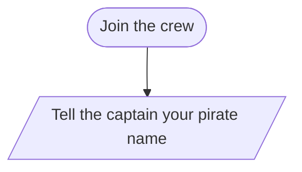

# Pirate Flowchart

**Partner 1:**
**Partner 2:**

Rename this file with your last name before you push, like `pirateFlowchart_smith.md`.

---

## Part 1: Sort the shapes

Write the shape for each part of the story: **Oval**, **Rectangle**, **Diamond**, or **Parallelogram**.

| Part of the story | Shape |
|---|---|
| Join the crew (the beginning) | |
| Tell the captain your pirate name | |
| Swab the deck | |
| Is the deck clean? | |
| Train on the cannon | |
| Count your hits | |
| 7 or more hits? | |
| Promoted to gunner | |
| Captain shouts Welcome, Gunner | |
| Does your buddy speak up for you? | |
| Become the ship's cook | |
| Captain says You're safe for now | |
| Did you eat the captain's last biscuit? | |
| Walk the plank | |
| Crew hears SPLASH | |
| Scrub the galley for a week | |
| The end of the week | |

**Where are the two loops?** (Which step goes back to which earlier step?)

1.
2.

---

## Part 2: The flowchart

Replace the starter code with your full flowchart.

---

## Part 3: Your twist

**What did you add, and where does it go in the story?**

(Write one or two sentences here. Your twist goes in the flowchart above.)
