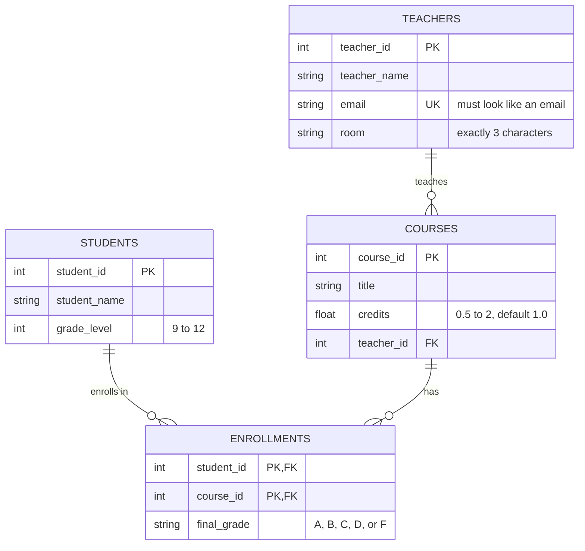

# Unit 4 Study Guide — Building Tables

**This is the file to keep open while you work.** It's not something you turn in. It's where you look things up when the follow-along or the walkthrough isn't enough.

Every example uses the **school database** from `unit4a_FollowAlong.md`: teachers, students, courses, and enrollments. Every example was actually run in SQLite, so the errors and output you see here are real.

The school database is **not** your client. Use these examples to see the shape of the SQL, then write your own from your client's starting design.

---

## Contents

1. [Two kinds of SQL: DDL and DML](#1-two-kinds-of-sql-ddl-and-dml)
2. [From design to schema to SQL](#2-from-design-to-schema-to-sql)
3. [Data types](#3-data-types)
4. [Naming rules](#4-naming-rules)
5. [CREATE TABLE](#5-create-table)
6. [Constraints](#6-constraints)
7. [Data validation with CHECK](#7-data-validation-with-check)
8. [Turning on foreign keys (PRAGMA)](#8-turning-on-foreign-keys-pragma)
9. [Order: create parents first, drop children first](#9-order-create-parents-first-drop-children-first)
10. [DROP TABLE IF EXISTS](#10-drop-table-if-exists)
11. [Comments](#11-comments)
12. [The whole script, start to finish](#12-the-whole-script-start-to-finish)
13. [INSERT INTO — adding rows to test your rules](#13-insert-into--adding-rows-to-test-your-rules)
14. [ER diagrams in Mermaid](#14-er-diagrams-in-mermaid)
15. [Doing it in DB Browser](#15-doing-it-in-db-browser)
16. [Error messages and what they mean](#16-error-messages-and-what-they-mean)
17. [Quick reference: every keyword in this unit](#17-quick-reference-every-keyword-in-this-unit)
18. [Vocabulary](#18-vocabulary)

---

## 1. Two kinds of SQL: DDL and DML

In Unit 2 you only **read** data with `SELECT`. In Unit 4 you build the tables that hold the data, then put data in them.

SQL commands come in two groups:

| Group | Stands for | What it works on | Commands |
|---|---|---|---|
| **DDL** | Data Definition Language | The **structure**: the tables themselves | `CREATE`, `ALTER`, `DROP` |
| **DML** | Data Manipulation Language | The **rows** inside the tables | `INSERT`, `UPDATE`, `DELETE`, `SELECT` |

An easy way to remember it: DDL builds the shelves, and DML puts things on the shelves and takes them off.

In this unit you use DDL to build the tables (`CREATE TABLE`, `DROP TABLE`) and DML to add test rows (`INSERT`) and look at them (`SELECT`).

---

## 2. From design to schema to SQL

You build a database in three steps. Each step adds more detail.

| Step | What it says | Example for one column |
|---|---|---|
| **Design** (your starting design) | Which tables and columns exist, and the keys | `teachers` has an `email` column |
| **Schema** (your Excel sheet) | Each column's data type and rules | `email`, TEXT, not null, unique, must look like an email |
| **SQL** (your `.sql` script) | The code that builds it | `email TEXT NOT NULL UNIQUE CHECK (email LIKE '%_@_%._%'),` |

### The schema sheet, column by column

Your `unit4a_lastname.xlsx` has one row for every column in the database. Here is what each column of the sheet means:

| Sheet column | What to put in it | Becomes this in SQL |
|---|---|---|
| `table_name` | Which table the column belongs to | Which `CREATE TABLE` it goes in |
| `column_name` | The column's name, exactly as in the starting design | The first word on the line |
| `data_type` | `INTEGER`, `REAL`, or `TEXT` | The second word on the line |
| `key` | `PK`, `FK → other_table`, both, or blank | `PRIMARY KEY` or a `FOREIGN KEY` line |
| `not_null` | `Y` if the column must have a value | `NOT NULL` |
| `unique` | `Y` if no two rows can have the same value | `UNIQUE` |
| `check_rule` | A test the value must pass | `CHECK (…)` |
| `default_value` | The value to use when nobody gives one | `DEFAULT …` |

**Each row of the schema becomes one line of SQL:** the name, then the type, then the rules.

**Why are primary keys not marked unique?** A primary key is always unique. That's part of what being a key means. So the `unique` column stays blank for keys. Marking it would just repeat the same rule.

**Why are primary keys marked not null?** In most databases a primary key can never be empty. SQLite has an old quirk: that's only guaranteed for a single `INTEGER PRIMARY KEY`. For any other key, including a composite key, you have to write `NOT NULL` yourself. Marking `Y` for every key column keeps you safe.

---

## 3. Data types

Every column gets a data type. SQLite only needs three:

| SQLite type | Holds | School examples |
|---|---|---|
| `INTEGER` | Whole numbers | `teacher_id`, `grade_level` |
| `REAL` | Numbers with decimals | `credits` (0.5, 1.0) |
| `TEXT` | Words, codes, and dates | `teacher_name`, `room`, `final_grade` |

**Store dates as `TEXT`** in the form `'YYYY-MM-DD'`, like `'2026-10-19'`. Written this way, dates sort in the right order.

**IDs that look like numbers aren't always numbers.** A room like `'214'` is `TEXT`, because you never do math with it, and some rooms might be `'B12'`. Ask: "Would I ever add or average this?" If not, it's probably `TEXT`.

### Data types on the exam

Other database systems (SQL Server, MySQL, Oracle) have more types, and **the certification exam uses their names**. Know what each one means and what SQLite uses instead:

| On the exam | What it is | SQLite uses |
|---|---|---|
| `INT` | Whole number | `INTEGER` |
| `DECIMAL(5,2)` | Decimal number: 5 digits total, 2 after the decimal point (largest is 999.99) | `REAL` |
| `FLOAT` | Decimal number | `REAL` |
| `VARCHAR(50)` | Text up to 50 characters | `TEXT` |
| `CHAR(3)` | Text of exactly 3 characters. Shorter values are padded with spaces. | `TEXT` |
| `DATE` | A date | `TEXT` as `'YYYY-MM-DD'` |
| `DATETIME` | A date and a time | `TEXT` as `'YYYY-MM-DD HH:MM:SS'` |
| `BOOLEAN` or `BIT` | True or false | `INTEGER` (1 = true, 0 = false) |

**SQLite won't enforce a length.** If you write `VARCHAR(3)`, SQLite accepts it, and then it will still store a 30-character value. In SQLite, a length rule has to be a `CHECK` (see [section 7](#7-data-validation-with-check)).

---

## 4. Naming rules

Good names mean nobody has to guess. This class follows these rules:

| Rule | Good | Bad |
|---|---|---|
| Lowercase with underscores (called **snake_case**) | `teacher_name` | `TeacherName`, `Teacher Name` |
| No spaces or special characters | `final_grade` | `final grade`, `final-grade`, `grade#` |
| Table names are plural | `teachers` | `teacher` |
| Column names are singular | `email` | `emails` |
| IDs end in `_id` | `course_id` | `courseNumber`, `id` |
| A foreign key uses the same name as the key it points at | `courses.teacher_id` → `teachers.teacher_id` | `courses.instructor` |
| Don't use SQL keywords as names | `order_date`, `course_group` | `order`, `group`, `table` |

**Why no spaces?** A name with a space has to be wrapped in quotes in every query you ever write: `"final grade"`. Forget the quotes once and the query breaks.

**Why no keywords?** SQL reads `order` as the start of `ORDER BY`, so a column named `order` confuses it.

Your client's starting design already follows these rules. Type the names exactly as they appear there.

---

## 5. CREATE TABLE

`CREATE TABLE` makes a new, empty table.

```sql
CREATE TABLE teachers (
    teacher_id    INTEGER PRIMARY KEY,
    teacher_name  TEXT    NOT NULL,
    email         TEXT    NOT NULL UNIQUE CHECK (email LIKE '%_@_%._%'),
    room          TEXT    CHECK (length(room) = 3)
);
```

How to read it:

- `CREATE TABLE teachers` — make a table named `teachers`.
- Everything about the table goes **inside the parentheses**.
- **One column per line**: the name, then the type, then any rules.
- **A comma after every line except the last one.** The last line before the `)` never gets a comma.
- `);` ends the statement.

The spacing doesn't matter to SQLite. Lining the columns up just makes it easier to read and to spot a missing comma.

### Rules that go on their own line

Some rules involve more than one column, or point at another table. These go on their own lines **after** all the columns:

```sql
CREATE TABLE enrollments (
    student_id    INTEGER NOT NULL,
    course_id     INTEGER NOT NULL,
    final_grade   TEXT    CHECK (final_grade IN ('A', 'B', 'C', 'D', 'F')),
    PRIMARY KEY (student_id, course_id),                        -- composite key
    FOREIGN KEY (student_id) REFERENCES students (student_id),  -- points at students
    FOREIGN KEY (course_id)  REFERENCES courses (course_id)     -- points at courses
);
```

The comma rule still applies. These lines are inside the parentheses, so every line gets a comma except the very last one.

---

## 6. Constraints

A **constraint** is a rule the database checks on every row. If a row breaks the rule, the database refuses the row and gives you an error. Nothing bad gets saved.

| Constraint | Means | Where it goes |
|---|---|---|
| `PRIMARY KEY` | Identifies each row. Can't repeat. | On the column, or its own line for a composite key |
| `FOREIGN KEY … REFERENCES` | The value must exist in another table | Its own line after the columns |
| `NOT NULL` | Must have a value | On the column |
| `UNIQUE` | No two rows can have the same value | On the column |
| `DEFAULT` | The value used when none is given | On the column |
| `CHECK` | The value must pass a test | On the column, or its own line |

Each one is explained below, with the error you get when a row breaks it.

### PRIMARY KEY

The primary key identifies each row, so no two rows can have the same one.

```sql
teacher_id  INTEGER PRIMARY KEY,
```

Trying to add a second teacher 1:

```sql
INSERT INTO teachers (teacher_id, teacher_name, email, room)
VALUES (1, 'Pat Gray', 'pgray@school.org', '301');
```
```
UNIQUE constraint failed: teachers.teacher_id
```

The error says `UNIQUE` because a primary key is unique by definition.

**A bonus of `INTEGER PRIMARY KEY`:** if you leave the ID out, SQLite picks the next number for you. Starting with the two teachers from the follow-along:

```sql
INSERT INTO teachers (teacher_name, email, room)
VALUES ('Lee Fox', 'lfox@school.org', '302');

SELECT teacher_id, teacher_name FROM teachers;
```
```
teacher_id  teacher_name
1           Ryan McMaster
2           Dana Lee
3           Lee Fox
```

Lee Fox got `3` without anyone typing it.

### Composite PRIMARY KEY

Sometimes no single column identifies a row, but two columns together do. That's a **composite key**. It's what a junction table uses.

In `enrollments`, one row is one student in one course. Jordan (40213) can be in many courses, so `student_id` repeats. Course 101 has many students, so `course_id` repeats. What can't repeat is the **pair**: Jordan can't be enrolled in course 101 twice.

```sql
PRIMARY KEY (student_id, course_id),
```

It goes on its own line after the columns. Trying to enroll Jordan in course 101 a second time:

```sql
INSERT INTO enrollments (student_id, course_id, final_grade)
VALUES (40213, 101, 'B');
```
```
UNIQUE constraint failed: enrollments.student_id, enrollments.course_id
```

⚠️ **Don't mark the columns of a composite key `UNIQUE` one at a time.** If `student_id` were `UNIQUE` by itself, each student could only be in one course. The script would still run with no error, and you wouldn't find the problem until the data wouldn't load.

### FOREIGN KEY

A foreign key says "this value must match a row in another table." This is **referential integrity** from Unit 3, now enforced by the database.

```sql
FOREIGN KEY (teacher_id) REFERENCES teachers (teacher_id)
```

Read it as: "the `teacher_id` in this table must be a `teacher_id` that exists in `teachers`."

Trying to give a course to teacher 99, who doesn't exist:

```sql
INSERT INTO courses (course_id, title, teacher_id)
VALUES (103, 'Web Design', 99);
```
```
FOREIGN KEY constraint failed
```

⚠️ **This only works if foreign keys are turned on.** See [section 8](#8-turning-on-foreign-keys-pragma). If they're off, teacher 99 gets saved with no error.

### NOT NULL

`NULL` means "no value." `NOT NULL` means the column can't be left empty.

```sql
title  TEXT  NOT NULL,
```

Trying to add a course with no title:

```sql
INSERT INTO courses (course_id, teacher_id)
VALUES (104, 2);
```
```
NOT NULL constraint failed: courses.title
```

**When to leave `NOT NULL` off:** when a missing value is normal. A teacher might not have a room. A student has no final grade until the course ends. In the school database, `room` and `final_grade` can be empty.

### UNIQUE

`UNIQUE` means no two rows can have the same value in that column.

```sql
email  TEXT  NOT NULL UNIQUE,
```

Trying to give a new teacher an email that's already taken:

```sql
INSERT INTO teachers (teacher_id, teacher_name, email, room)
VALUES (3, 'Sam Ortiz', 'rmcmaster@school.org', '220');
```
```
UNIQUE constraint failed: teachers.email
```

⚠️ **Only use `UNIQUE` where it's really true.** Before you add it, ask: **"Could two rows ever honestly have the same value here?"**

| Column | Could two rows match? | UNIQUE? |
|---|---|---|
| `email` | No. Everyone has their own email. | Yes |
| `teacher_name` | Yes. Two teachers can have the same name. | No |
| `room` | Yes. Two teachers can share a room at different times. | No |
| `title` | Yes. Two sections can both be called "Web Design." | No |

Remember Unit 3: two characters named Shadow, two albums named *Scorpion*, two players named Max Muncy. Put `UNIQUE` on a name column and the real data won't load.

**Don't put `UNIQUE` on a primary key.** It doesn't cause an error, but the key is already unique, so it does nothing.

### DEFAULT

`DEFAULT` gives a column a value when nobody types one in.

```sql
credits  REAL  NOT NULL DEFAULT 1.0,
```

Adding a course without saying how many credits:

```sql
INSERT INTO courses (course_id, title, teacher_id)
VALUES (101, 'Database Applications', 1);

SELECT * FROM courses;
```
```
course_id  title                  credits  teacher_id
101        Database Applications  1.0      1
```

`credits` is `1.0`, from the default.

**A default and `NOT NULL` work well together.** The column always has a value, and nobody has to type the common one.

Text defaults go in single quotes: `status TEXT DEFAULT 'active'`.

### CHECK

`CHECK` makes the value pass a test before it's saved. It's the main tool for data validation, so it gets its own section next.

---

## 7. Data validation with CHECK

**Data validation** means stopping bad data before it gets in, instead of cleaning it up later. You decide the rules once, in the `CREATE TABLE`, and the database checks every row from then on.

A `CHECK` holds a test in parentheses. If the test is true, the row is saved. If it's false, the row is refused.

The exam names four kinds of checks:

| Kind | Asks | School example |
|---|---|---|
| **Range check** | Is the number between a low and a high? | `CHECK (grade_level BETWEEN 9 AND 12)` |
| **Length check** | Is the text the right length? | `CHECK (length(room) = 3)` |
| **Format check** | Does the text have the right shape? | `CHECK (email LIKE '%_@_%._%')` |
| **List check** | Is it one of the allowed values? | `CHECK (final_grade IN ('A', 'B', 'C', 'D', 'F'))` |

### Range check

```sql
grade_level  INTEGER NOT NULL CHECK (grade_level BETWEEN 9 AND 12),
```

`BETWEEN 9 AND 12` includes 9 and 12. An 8th grader is refused:

```sql
INSERT INTO students (student_id, student_name, grade_level)
VALUES (40214, 'Avery Diaz', 8);
```
```
CHECK constraint failed: grade_level BETWEEN 9 AND 12
```

You can also use `>`, `<`, `>=`, and `<=`: `CHECK (credits > 0)`.

### Length check

```sql
room  TEXT  CHECK (length(room) = 3),
```

`length()` counts the characters. A 4-character room is refused:

```sql
INSERT INTO teachers (teacher_id, teacher_name, email, room)
VALUES (3, 'Sam Ortiz', 'sortiz@school.org', '2200');
```
```
CHECK constraint failed: length(room) = 3
```

For a maximum instead of an exact length, use `<=`: `CHECK (length(username) <= 20)`.

### Format check with LIKE

```sql
email  TEXT  NOT NULL UNIQUE CHECK (email LIKE '%_@_%._%'),
```

You used `LIKE` in Unit 2 to search. Here it tests whether a value has the right shape. It has two wildcards:

| Wildcard | Matches |
|---|---|
| `%` | Any number of characters, **including none** |
| `_` | **Exactly one** character |

Every other character must match exactly, including `@` and `.`.

Here's `'%_@_%._%'` piece by piece:

| Piece | Means |
|---|---|
| `%_` | at least one character |
| `@` | an @ sign |
| `_%` | at least one character |
| `.` | a period |
| `_%` | at least one character |

So the rule says: something, then @, then something, then a period, then something.

| Value | Passes? | Why |
|---|---|---|
| `rmcmaster@school.org` | Yes | Has every piece |
| `sam.ortiz` | No | No @ |
| `@school.org` | No | Nothing before the @ |
| `sortiz@school` | No | No period after the @ |

**Why `%_` and not just `%`?** Because `%` can match nothing. With `'%@%.%'`, the value `@.` would pass. Putting `_` next to `%` means "at least one character here."

This is a rough shape check. It still lets through junk like `a@b.c`. That's fine for this class. The point is to catch obvious mistakes.

### List check with IN

```sql
final_grade  TEXT  CHECK (final_grade IN ('A', 'B', 'C', 'D', 'F')),
```

The value has to be one of the items in the list. Text values go in single quotes. An `E` is refused:

```sql
INSERT INTO enrollments (student_id, course_id, final_grade)
VALUES (40213, 102, 'E');
```
```
CHECK constraint failed: final_grade IN ('A', 'B', 'C', 'D', 'F')
```

A list check is case-sensitive. `'a'` is not the same as `'A'`.

### Checking two columns against each other

A `CHECK` that uses two columns goes on its own line after the columns:

```sql
CREATE TABLE class_sizes (
    section_id     INTEGER PRIMARY KEY,
    max_students   INTEGER NOT NULL,
    enrolled       INTEGER NOT NULL,
    CHECK (enrolled <= max_students)
);
```

This refuses any row where more students are enrolled than the room holds.

### CHECK and empty values

A `CHECK` lets `NULL` through. In the school database, a teacher with no room is fine, even with the length check, because there's nothing to measure. If a column must have a value **and** pass a test, use both: `NOT NULL CHECK (…)`.

### Every rule has to fit the real data

When you add your client's data later, every row has to pass every rule. If you write `CHECK (level BETWEEN 1 AND 40)` and the data has a level-44 character, that row won't load. **Look at the client's spreadsheet before you pick a limit.**

---

## 8. Turning on foreign keys (PRAGMA)

A **pragma** is a SQLite setting. It doesn't create or change data. It changes how SQLite behaves.

SQLite comes with **foreign key checking turned off**. That's left over from older versions. If you don't turn it on, your `FOREIGN KEY` lines are saved but never checked, so a course could point at teacher 99 and nothing would stop it.

There are two ways to turn it on:

**In DB Browser:** Click the **Edit Pragmas** tab, check **Foreign Keys**, and click **Save**.

**In SQL:** Put this at the top of your script:

```sql
PRAGMA foreign_keys = ON;
```

**How to test it:** Try inserting a row that points at something that doesn't exist, like a course for teacher 99. If you get `FOREIGN KEY constraint failed`, foreign keys are on. If the row is saved with no error, they're off.

---

## 9. Order: create parents first, drop children first

A **parent table** is one that other tables point at. A **child table** has a foreign key that points at a parent.

In the school database:

| Table | Points at | So it's a |
|---|---|---|
| `teachers` | nothing | parent |
| `students` | nothing | parent |
| `courses` | `teachers` | child of `teachers`, and a parent of `enrollments` |
| `enrollments` | `students` and `courses` | child |

### Create parents first

A foreign key should point at a table that's already there. So create the tables in this order:

```
teachers  →  students  →  courses  →  enrollments
```

A table that points at nothing can go anywhere at the start. A junction table always goes last.

### Drop children first

When you delete tables, go in the **opposite** order:

```
enrollments  →  courses  →  students  →  teachers
```

If a child table has rows that point at a parent, SQLite won't let you drop the parent first:

```
FOREIGN KEY constraint failed
```

Dropping children first always works.

**Your starting design lists the tables in create order.** Flip it for your `DROP` lines.

---

## 10. DROP TABLE IF EXISTS

### Why you rebuild while you work

While you're building a database, you'll find mistakes. Maybe you forgot a `CHECK` rule or misspelled a column. You fix the script and run it again. But SQLite won't create a table that's already there:

```
table teachers already exists
```

SQLite also can't change the rules on a column that already exists. So the simple fix is to **delete the old tables and build them again** from your corrected script.

### What the lines do

```sql
DROP TABLE IF EXISTS enrollments;
```

- `DROP TABLE` deletes a table.
- `IF EXISTS` means "only if it's there." The first time you run the script, there's nothing to delete, and this keeps it from causing an error.

With these lines at the top, your routine is: **fix the script, run it, check it, and repeat until it's right.** Every run starts clean.

**Test it:** Run your whole script twice in a row. If the second run has no errors, your `DROP` lines work.

⚠️ **`DROP TABLE` deletes the table and every row in it.** That's fine while your tables are empty. Once they have data in them, running the script again erases the data. There's no undo.

---

## 11. Comments

`--` starts a comment. SQLite ignores everything after `--` on that line.

```sql
-- teachers: one row = one teacher
CREATE TABLE teachers (
    teacher_id  INTEGER PRIMARY KEY,   -- a comment can go at the end of a line too
```

Your script should have:

- A comment at the top saying what the database is
- A comment above each table saying **what one row is**: `-- enrollments: one row = one student in one course`

Writing "one row = …" makes you think about what the table really holds. If you can't finish the sentence, the design has a problem.

---

## 12. The whole script, start to finish

This is the school database as one script. Your `unit4a_lastname.sql` follows the same layout:

1. A comment saying what the database is
2. `PRAGMA foreign_keys = ON;`
3. `DROP TABLE IF EXISTS` for every table, **children first**
4. `CREATE TABLE` for every table, **parents first**, each with a comment

```sql
-- =========================================
-- School demo database
-- =========================================

-- Make SQLite check foreign keys
PRAGMA foreign_keys = ON;

-- Drop children first, parents last
DROP TABLE IF EXISTS enrollments;
DROP TABLE IF EXISTS courses;
DROP TABLE IF EXISTS students;
DROP TABLE IF EXISTS teachers;

-- Create parents first, children last

-- teachers: one row = one teacher
CREATE TABLE teachers (
    teacher_id    INTEGER PRIMARY KEY,
    teacher_name  TEXT    NOT NULL,
    email         TEXT    NOT NULL UNIQUE CHECK (email LIKE '%_@_%._%'),
    room          TEXT    CHECK (length(room) = 3)
);

-- students: one row = one student
CREATE TABLE students (
    student_id    INTEGER PRIMARY KEY,
    student_name  TEXT    NOT NULL,
    grade_level   INTEGER NOT NULL CHECK (grade_level BETWEEN 9 AND 12)
);

-- courses: one row = one course
CREATE TABLE courses (
    course_id     INTEGER PRIMARY KEY,
    title         TEXT    NOT NULL,
    credits       REAL    NOT NULL DEFAULT 1.0 CHECK (credits BETWEEN 0.5 AND 2),
    teacher_id    INTEGER NOT NULL,
    FOREIGN KEY (teacher_id) REFERENCES teachers (teacher_id)
);

-- enrollments: one row = one student in one course
CREATE TABLE enrollments (
    student_id    INTEGER NOT NULL,
    course_id     INTEGER NOT NULL,
    final_grade   TEXT    CHECK (final_grade IN ('A', 'B', 'C', 'D', 'F')),
    PRIMARY KEY (student_id, course_id),
    FOREIGN KEY (student_id) REFERENCES students (student_id),
    FOREIGN KEY (course_id)  REFERENCES courses (course_id)
);
```

### Checklist for your script

- [ ] A comment at the top
- [ ] `PRAGMA foreign_keys = ON;`
- [ ] A `DROP TABLE IF EXISTS` for every table, children first
- [ ] A `CREATE TABLE` for every table in your starting design, parents first
- [ ] A "one row = …" comment above each table
- [ ] Every column from your schema sheet, with the same name, type, and rules
- [ ] Every primary key and foreign key, including the composite key on the junction table
- [ ] No comma before any `)`
- [ ] Runs twice in a row with no errors

---

## 13. INSERT INTO — adding rows to test your rules

`INSERT INTO` adds a row to a table. In this part of the unit you use it to **test your rules**: add good rows and make sure they save, add bad rows and make sure they're refused.

### The shape

```sql
INSERT INTO teachers (teacher_id, teacher_name, email, room)
VALUES (1, 'Ryan McMaster', 'rmcmaster@school.org', '214');
```

- `INSERT INTO teachers` — which table
- `(teacher_id, teacher_name, email, room)` — which columns you're filling in
- `VALUES (…)` — the values, **in the same order as the columns**

### Quotes

| Kind of value | Quotes? | Example |
|---|---|---|
| Text | Single quotes | `'Ryan McMaster'`, `'214'` |
| Number | No quotes | `1`, `11`, `0.5` |
| Empty | No quotes | `NULL` |

Forgetting the quotes on text breaks the statement:

```sql
INSERT INTO students (student_id, student_name, grade_level)
VALUES (40222, Casey Moore, 10);
```
```
near "Moore": syntax error
```

Always use **single** quotes for text. Double quotes are for names of tables and columns, not values.

### Leaving columns out

You don't have to list every column. A column you leave out gets its `DEFAULT`, or `NULL` if it has no default.

```sql
INSERT INTO teachers (teacher_id, teacher_name, email)
VALUES (3, 'Sam Ortiz', 'sortiz@school.org');
```

No room was given, so `room` is `NULL`. That's allowed, because `room` isn't `NOT NULL`.

Leaving out a `NOT NULL` column with no default gives an error. See [NOT NULL](#not-null).

### Always list the columns

You can skip the column list, but then you have to give a value for **every** column, in the exact order of the table:

```sql
INSERT INTO students VALUES (40221, 'Casey Moore');
```
```
table students has 3 columns but 2 values were supplied
```

Listing the columns is clearer and safer. Do it every time.

### Checking what you added

Use `SELECT` from Unit 2 to look at the rows:

```sql
SELECT * FROM teachers;
```
```
teacher_id  teacher_name   email                 room
1           Ryan McMaster  rmcmaster@school.org  214
2           Dana Lee       dlee@school.org       108
3           Sam Ortiz      sortiz@school.org     NULL
```

### Testing every rule

A good test plan has **one bad row for each rule**, so you see every rule refuse something. For the school database:

| Rule | A row that should be refused | Error |
|---|---|---|
| Primary key | A second teacher 1 | `UNIQUE constraint failed: teachers.teacher_id` |
| Composite key | Jordan in course 101 again | `UNIQUE constraint failed: enrollments.student_id, enrollments.course_id` |
| Foreign key | A course for teacher 99 | `FOREIGN KEY constraint failed` |
| NOT NULL | A course with no title | `NOT NULL constraint failed: courses.title` |
| UNIQUE | A teacher with a taken email | `UNIQUE constraint failed: teachers.email` |
| Range check | An 8th grader | `CHECK constraint failed: grade_level BETWEEN 9 AND 12` |
| Length check | Room `'2200'` | `CHECK constraint failed: length(room) = 3` |
| Format check | Email `'sam.ortiz'` | `CHECK constraint failed: email LIKE '%_@_%._%'` |
| List check | Final grade `'E'` | `CHECK constraint failed: final_grade IN ('A', 'B', 'C', 'D', 'F')` |

If a bad row gets saved with no error, the rule is missing or written wrong. Fix the script, run it again, and test again.

Remember to click **Write Changes** to save the good rows.

---

## 14. ER diagrams in Mermaid

An **ER diagram** (entity-relationship diagram) is a picture of the tables and how they connect. In this unit you get one from AI by giving it your schema sheet, and then you check it.

### Reading the code



If the diagram doesn't show up as a picture, copy the code and paste it into **https://mermaid.live/**.

| Code | Means |
|---|---|
| `TEACHERS ||--o{ COURSES : "teaches"` | One teacher teaches many courses |
| `int teacher_id PK` | Type, then name, then key |
| `PK`, `FK`, `UK` | Primary key, foreign key, unique |
| `PK, FK` | Part of a composite key **and** a foreign key |
| `"9 to 12"` | A comment, used here for the `CHECK` rule |

Mermaid uses its own type names (`int`, `string`, `float`). They mean the same as `INTEGER`, `TEXT`, and `REAL`.

### The line endings

| Symbol | Means |
|---|---|
| `||` | exactly one |
| `o{` | zero or more (the crow's foot) |
| `|{` | one or more |
| `o|` | zero or one |

### Checking the AI's diagram

AI makes mistakes. Before you use its diagram, check:

- [ ] Every table and every column from your schema is there
- [ ] Every key is marked `PK`, `FK`, or `UK`
- [ ] The junction table's two columns are both `PK, FK`
- [ ] The crow's foot (`o{`) is on the **many** side of every line
- [ ] Each line reads correctly out loud: "One teacher, many courses."

---

## 15. Doing it in DB Browser

### Make a new database

1. Open **DB Browser for SQLite**.
2. **File → New Database.** Give it a name and save it in your repo's unit4 folder.
3. A window pops up asking you to define a table. Click **Cancel**. You're writing SQL instead.

**About that window:** DB Browser can build a table with buttons and checkboxes instead of SQL. The bottom of that window even shows the `CREATE TABLE` code it's writing for you. This class writes the SQL itself, because the script is what you turn in, it can be run again any time, and the exam tests the SQL, not the buttons.

### Turn on foreign keys

4. Click the **Edit Pragmas** tab. Check **Foreign Keys**. Click **Save**.

### Run SQL

5. Click the **Execute SQL** tab. Type or paste your SQL.
6. To run it, click ▶ or press **Ctrl+Return** (**Cmd+Return** on a Mac).
7. Read the panel at the bottom. It says whether the SQL ran or shows the error.

### Save your work

8. Click **Write Changes** at the top of DB Browser, or press **Ctrl+S** (**Cmd+S** on a Mac).

DB Browser holds your changes in memory until you click Write Changes. If you close DB Browser without clicking it, your work is lost.

### See your tables

9. Click the **Database Structure** tab. Click the arrow next to a table to see its columns.

**Don't see a new table?** The tab doesn't always update on its own. Press **F5** (or **Cmd+R** on a Mac), or go to **View → Refresh**.

10. To see the rows in a table, use the **Browse Data** tab, or run `SELECT * FROM table_name;` in Execute SQL.

---

## 16. Error messages and what they mean

The error message usually names the problem. Read it before you change anything.

### Errors when building tables

| Error | Usual cause | Fix |
|---|---|---|
| `near ")": syntax error` | A comma after the last line, right before `)` | Remove the comma before `)` |
| `near "room": syntax error` (any word) | A missing comma on the line **before** that word | Add the comma at the end of the line above |
| `table teachers already exists` | You ran the `CREATE` again without dropping the table first | Add `DROP TABLE IF EXISTS` lines at the top |
| `FOREIGN KEY constraint failed` (on a `DROP`) | You dropped a parent while a child still had rows pointing at it | Drop children first |

### Errors when adding rows

| Error | Which rule stopped it |
|---|---|
| `UNIQUE constraint failed: teachers.teacher_id` | Primary key: that ID is already used |
| `UNIQUE constraint failed: enrollments.student_id, enrollments.course_id` | Composite key: that pair is already there |
| `UNIQUE constraint failed: teachers.email` | UNIQUE: that value is already used |
| `NOT NULL constraint failed: courses.title` | NOT NULL: no value was given |
| `CHECK constraint failed: …` | CHECK: the error shows which test failed |
| `FOREIGN KEY constraint failed` | Foreign key: the value doesn't exist in the parent table |
| `no such table: main.teachers` | A foreign key points at a table that doesn't exist. Check the spelling and the order. |
| `table students has 3 columns but 2 values were supplied` | You skipped the column list and didn't give a value for every column |
| `near "Moore": syntax error` | Text without quotes |

### A bad row got saved with no error

- **Foreign key:** foreign keys are probably off. See [section 8](#8-turning-on-foreign-keys-pragma).
- **Anything else:** the rule is missing from your `CREATE TABLE`, or the test is written wrong. Check the line in your script against your schema sheet.

---

## 17. Quick reference: every keyword in this unit

### Building tables

| Keyword | What it does | Example |
|---|---|---|
| `CREATE TABLE` | Makes a new table | `CREATE TABLE teachers ( … );` |
| `DROP TABLE` | Deletes a table and all its rows | `DROP TABLE teachers;` |
| `IF EXISTS` | Only if it's there | `DROP TABLE IF EXISTS teachers;` |
| `PRAGMA foreign_keys = ON` | Turns on foreign key checking | `PRAGMA foreign_keys = ON;` |
| `--` | Comment | `-- one row = one teacher` |

### Data types

| Keyword | Holds |
|---|---|
| `INTEGER` | Whole numbers |
| `REAL` | Decimals |
| `TEXT` | Words, codes, dates |

### Constraints

| Keyword | Means |
|---|---|
| `PRIMARY KEY` | Identifies each row; can't repeat |
| `PRIMARY KEY (a, b)` | Composite key: the pair can't repeat |
| `FOREIGN KEY (a) REFERENCES t (a)` | Value must exist in table `t` |
| `NOT NULL` | Can't be empty |
| `UNIQUE` | No two rows can match |
| `DEFAULT value` | Used when no value is given |
| `CHECK (test)` | Value must pass the test |

### Inside a CHECK

| Keyword | Example |
|---|---|
| `BETWEEN … AND …` | `grade_level BETWEEN 9 AND 12` |
| `>` `<` `>=` `<=` `=` | `credits > 0` |
| `length()` | `length(room) = 3` |
| `LIKE` with `%` and `_` | `email LIKE '%_@_%._%'` |
| `IN (…)` | `final_grade IN ('A', 'B', 'C', 'D', 'F')` |

### Adding and viewing rows

| Keyword | What it does | Example |
|---|---|---|
| `INSERT INTO … VALUES` | Adds a row | `INSERT INTO students (student_id, student_name, grade_level) VALUES (40213, 'Jordan Kim', 11);` |
| `NULL` | No value | `VALUES (3, 'Sam Ortiz', 'sortiz@school.org', NULL)` |
| `SELECT * FROM` | Shows every row | `SELECT * FROM students;` |

---

## 18. Vocabulary

| Term | Meaning |
|---|---|
| **DDL** (Data Definition Language) | SQL that builds and changes tables: `CREATE`, `ALTER`, `DROP` |
| **DML** (Data Manipulation Language) | SQL that works with rows: `INSERT`, `UPDATE`, `DELETE`, `SELECT` |
| **Schema** | The full description of a database: its tables, columns, data types, and rules |
| **Data dictionary** | A document listing every column in a database and what it holds. Your schema sheet is one. |
| **Data type** | The kind of value a column holds, like `INTEGER` or `TEXT` |
| **Constraint** | A rule the database checks on every row |
| **Primary key** | The column (or columns) that identifies each row |
| **Composite key** | A primary key made of two or more columns together |
| **Foreign key** | A column whose value must match a key in another table |
| **Referential integrity** | Every foreign key points at a row that really exists |
| **Parent table** | A table that other tables point at |
| **Child table** | A table with a foreign key pointing at a parent |
| **Junction table** | A table that connects two tables in a many-to-many relationship. Its key is usually composite. |
| **NULL** | No value. Not zero and not blank text — nothing at all. |
| **Default** | The value a column gets when none is given |
| **Data validation** | Stopping bad data before it's saved |
| **Range check** | A test that a number is between a low and a high |
| **Length check** | A test that text is the right length |
| **Format check** | A test that text has the right shape, like an email |
| **List check** | A test that a value is one of an allowed list |
| **Pragma** | A SQLite setting, like turning on foreign keys |
| **Script** | A file of SQL that runs from top to bottom |
| **snake_case** | Naming with lowercase words joined by underscores: `teacher_name` |
| **ER diagram** | A picture of the tables and how they connect |
| **Crow's foot** | The three-pronged line ending that means "many" in an ER diagram |
