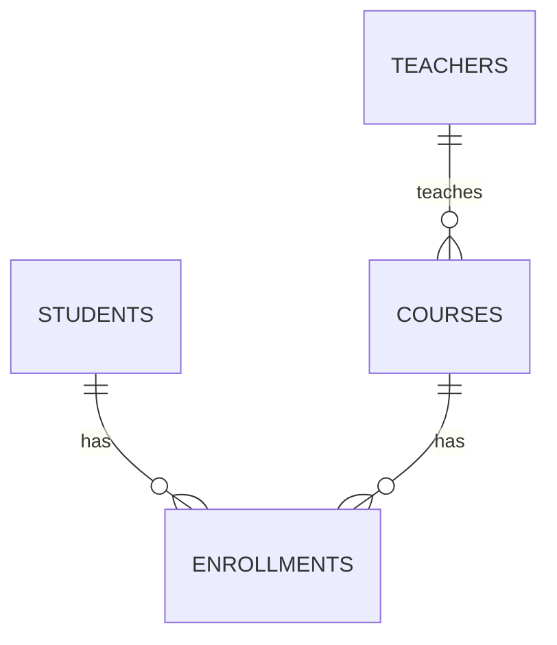
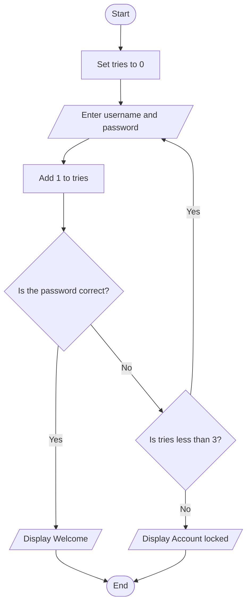

# Unit 5 Study Guide — Database Applications WebXam Review

**This guide covers everything on the Database Applications WebXam (145085).** The test is 45 multiple-choice questions. Most of it is material you already did in Units 1–4. A few topics (security, laws, backups, user access) are new in Unit 5.

How to use it:

- Each section starts with the ideas you need, then a table or example. The tables are the fastest way to review.
- Every SQL example was run on the **school database** from Unit 4 (teachers, students, courses, enrollments), so the output shown is real.
- The exam asks you to **recognize and pick**, not to build. Most questions sound like "Which term describes...", "Which constraint would stop...", or "What does this query return?"
- Section 13 has practice questions with hidden answers. Try each one before you open the answer.
- The programming part of the exam has its own longer guide: [Programming Review Study Guide](../examReview/programmingReview_StudyGuide.md). Section 12 here is the short version.

---

## Contents

1. [Database basics](#1-database-basics)
2. [Getting data out with SQL](#2-getting-data-out-with-sql)
3. [Database design](#3-database-design)
4. [Building tables and checking data](#4-building-tables-and-checking-data)
5. [Changing data and transactions](#5-changing-data-and-transactions)
6. [Managing a database](#6-managing-a-database)
7. [Security](#7-security)
8. [Laws and ethics](#8-laws-and-ethics)
9. [Careers and professional organizations](#9-careers-and-professional-organizations)
10. [AI and databases](#10-ai-and-databases)
11. [Flowcharts and other planning tools](#11-flowcharts-and-other-planning-tools)
12. [Programming review](#12-programming-review)
13. [Practice questions](#13-practice-questions)
14. [Vocabulary](#14-vocabulary)

---

## 1. Database basics

*Unit 1 · Exam competencies 2.8.1–2.8.9*

### Data vs. information

| | Means | Example |
|---|---|---|
| **Data** | Raw facts with no meaning on their own | `121  104  2024-11-08  W` |
| **Information** | Data with context, so it's useful | The Cavaliers beat the Bucks 121–104 on November 8th. |

A database's job is to store data so it can be turned into information.

### Database vs. DBMS

- A **database** is an organized collection of data.
- A **DBMS** (Database Management System) is the software that stores the data, runs queries, and enforces the rules. Examples: SQLite, MySQL, PostgreSQL, Oracle, Microsoft SQL Server, MongoDB.

| A DBMS handles | So that |
|---|---|
| Storing and finding data | Nobody has to write file-reading code |
| Many users at once | People don't overwrite each other's work |
| Permissions | Not everyone can see or change everything |
| Rules (constraints) | Bad data like a grade level of 47 gets refused |
| Backup and recovery | A dead hard drive doesn't lose everything |

**Why not a spreadsheet?** A spreadsheet is good for *looking at* data. It breaks down with many users, repeated data typed thousands of times, no rules, and no permissions. A database is built for *managing* data.

### The parts of a database

| Part | Other names | Means |
|---|---|---|
| **Table** | Entity, relation | Data about one subject (students) |
| **Row** | Record, tuple | One item in the table (one student) |
| **Column** | Field, attribute | One kind of fact (grade level) |
| **Field** (cell) | Value | Where one row and one column cross |
| **Primary key** | PK | The column that uniquely identifies each row |
| **Foreign key** | FK | A column that points to another table's primary key. This links tables. |
| **Relationship** | | How two tables connect, through a foreign key |
| **Schema** | | The blueprint: tables, columns, types, keys, and rules. Not the data itself. |
| **Transaction** | | A group of changes that all happen or all get undone |
| **Normalization** | | Splitting data into tables so each fact is stored once |

### Types of databases

Know each one by name and what it's for.

| Type | Built for |
|---|---|
| **Relational** | Tables linked by keys. The most common type. Uses SQL. |
| **NoSQL / Document** | Flexible records (often JSON). Each record can have different fields. |
| **Graph** | Connections: friends, followers, flight routes. Stores nodes and edges. |
| **Object-oriented** | Stores program objects directly, without tables |
| **Data warehouse** | Years of history from many sources, for reports and analysis |
| **Distributed** | One database spread across many computers or locations |
| **Open source** | Free source code anyone can use and change (MySQL, PostgreSQL, SQLite) |
| **Cloud** | Hosted and managed by a provider over the internet (Azure SQL, Amazon RDS) |
| **Artificial intelligence** | Stores the large amounts of data used to train and run AI models |

### Database structures

| Structure | What it looks like | Example |
|---|---|---|
| **Flat file** | One table, no relationships | A CSV file |
| **Hierarchical** | A tree. Each record has exactly one parent. | Folders on a drive, an org chart |
| **Relational** | Many tables joined by keys | Our school database |
| **Data lake** | Huge amounts of raw data in any format, organized later when needed | Every log file and photo a company collects |
| **Object-oriented** | Objects with their own data and methods | A game saving character objects |
| **Cloud** | Stored and run on a provider's servers | Google's or Microsoft's databases |
| **Multi-modal** (multi-model) | One system that can store several kinds (tables, documents, graphs) | Azure Cosmos DB |

### Front-end and back-end

| | What it is | Example: checking your grades |
|---|---|---|
| **Front-end** | What users see and touch: screens, buttons, forms | The grade website you log into |
| **Back-end** | The database itself: tables, keys, rules. Users never see it. | The database holding every grade in the building |

Three front-end tools that let people use a database without writing SQL:

| Tool | Does | Example |
|---|---|---|
| **Form** | Enter or edit one record at a time | A class sign-up screen |
| **Filter** | Narrows what's shown | "Only show my classes" |
| **Report** | Formatted output to read or print | A report card, a receipt |

Behind every form, filter, and report is a query the user never sees.

### What SQL is

**SQL** (Structured Query Language) is the language for working with relational databases. It is split into groups:

| Group | Stands for | Commands | Works on |
|---|---|---|---|
| **DDL** | Data Definition Language | `CREATE`, `ALTER`, `DROP` | The **structure** (tables) |
| **DML** | Data Manipulation Language | `SELECT`, `INSERT`, `UPDATE`, `DELETE` | The **rows** (data) |
| **DCL** | Data Control Language | `GRANT`, `REVOKE` | **Permissions** |
| **TCL** | Transaction Control Language | `BEGIN`, `COMMIT`, `ROLLBACK` | **Transactions** |

**Getting data in:** typing it, a form, a CSV import, or another program writing it.
**Getting data out:** a query, an export (CSV, Excel), or a report.

### Integrity vs. security

- **Data integrity** = the data is **correct and consistent**. No course pointing to a teacher who doesn't exist. No student in grade 47.
- **Data security** = only the **right people** can see or change the data.

Integrity is about *accuracy*. Security is about *access*. Both are on the exam.

---

## 2. Getting data out with SQL

*Unit 2 · Exam competencies 8.5.3, 8.5.4*

The school database used in every example:

```
teachers     (teacher_id PK, teacher_name, email, room)
students     (student_id PK, student_name, grade_level)
courses      (course_id PK, title, credits, teacher_id FK → teachers)
enrollments  (student_id FK, course_id FK, final_grade)   PK = (student_id, course_id)
```

### The order of a query

Clauses always go in this order. Not every query uses every clause.

```sql
SELECT    columns            -- what to show
FROM      table              -- where it comes from
JOIN      other table ON ... -- link another table
WHERE     condition          -- filter rows (before grouping)
GROUP BY  column             -- make groups
HAVING    condition          -- filter groups (after grouping)
ORDER BY  column             -- sort
LIMIT     number;            -- how many rows to show
```

### SELECT, WHERE, ORDER BY

```sql
-- Seniors, sorted A to Z by name
SELECT student_name, grade_level
FROM   students
WHERE  grade_level = 12
ORDER BY student_name;
```
```
student_name  grade_level
Avery Diaz    12
Maya Chen     12
```

- `SELECT *` means every column.
- `ORDER BY` sorts **ascending** (A–Z, low to high) by default. Add `DESC` for descending.
- Text goes in **single quotes**: `WHERE title = 'Web Design'`.

### Filtering with logic

| Keyword | Example | Means |
|---|---|---|
| `AND` | `credits >= 1 AND teacher_id = 1` | Both must be true |
| `OR` | `grade_level = 11 OR grade_level = 12` | At least one must be true |
| `NOT` | `NOT grade_level = 9` | Flips true and false |
| `BETWEEN` | `grade_level BETWEEN 10 AND 12` | In a range, **including** both ends |
| `IN` | `final_grade IN ('A', 'B')` | Matches any value in the list |
| `LIKE` | `student_name LIKE 'M%'` | Matches a pattern |
| `IS NULL` | `final_grade IS NULL` | The field is empty |

**LIKE wildcards:**

| Wildcard | Matches | Example | Finds |
|---|---|---|---|
| `%` | Any number of characters, including none | `'M%'` | Maya Chen |
| `_` | Exactly one character | `'_ack'` | Jack, Zack |

**Never write `= NULL`.** NULL means "no value," so nothing equals it. Use `IS NULL` or `IS NOT NULL`.

```sql
-- Which enrollment has no grade yet?
SELECT student_id, course_id
FROM   enrollments
WHERE  final_grade IS NULL;
```
```
student_id  course_id
40213       102
```

### Calculated fields and functions

A **calculated field** is a column that doesn't exist in the table. The query makes it. `AS` gives it a name (an **alias**).

```sql
SELECT student_name,
       UPPER(student_name)                     AS shout,
       SUBSTR(student_name, 1, 3)              AS first3,
       student_name || ' (' || grade_level || ')' AS label
FROM   students
LIMIT  2;
```
```
student_name  shout         first3  label
Jordan Price  JORDAN PRICE  Jor     Jordan Price (11)
Maya Chen     MAYA CHEN     May     Maya Chen (12)
```

| Function | Does |
|---|---|
| `UPPER()` / `LOWER()` | Changes to capital or lowercase letters |
| `SUBSTR(text, start, length)` | Takes part of the text. Starts counting at 1 in SQL. |
| `\|\|` | Joins text together (concatenation). Some databases use `+` or `CONCAT()`. |
| `ROUND(number, places)` | Rounds a number |
| `LENGTH()` | Counts the characters |

### Aggregate functions

An **aggregate function** takes many rows and gives back one answer.

```sql
SELECT COUNT(*)         AS how_many,
       AVG(grade_level) AS avg_grade,
       MIN(grade_level) AS lowest,
       MAX(grade_level) AS highest
FROM   students;
```
```
how_many  avg_grade  lowest  highest
5         11.4       11      12
```

`SUM()` adds up a column. `COUNT(*)` counts rows. `COUNT(column)` counts only the rows where that column is not NULL.

### GROUP BY and HAVING

`GROUP BY` makes one group per value and runs the aggregate on each group.

```sql
-- How many students are in each course?
SELECT course_id, COUNT(*) AS students
FROM   enrollments
GROUP BY course_id;
```
```
course_id  students
101        3
102        3
103        2
```

`HAVING` filters the **groups**. `WHERE` filters the **rows** before they're grouped.

```sql
-- Only courses with 3 or more students
SELECT course_id, COUNT(*) AS students
FROM   enrollments
GROUP BY course_id
HAVING COUNT(*) >= 3;
```
```
course_id  students
101        3
102        3
```

**Easy way to remember:** `WHERE` = before grouping, single rows. `HAVING` = after grouping, uses `COUNT`, `SUM`, `AVG`, etc.

### Joins

A **join** puts rows from two tables together where the keys match.

```sql
-- Who is in Web Design, and what grade did they get?
SELECT s.student_name, c.title, e.final_grade
FROM   enrollments AS e
JOIN   students AS s ON e.student_id = s.student_id
JOIN   courses  AS c ON e.course_id  = c.course_id
WHERE  c.title = 'Web Design';
```
```
student_name  title       final_grade
Jordan Price  Web Design  B
Eli Brooks    Web Design  NULL
Avery Diaz    Web Design  B
```

- The `ON` line says which columns match. It's almost always **foreign key = primary key**.
- `e`, `s`, and `c` are **table aliases**, short nicknames so you don't type the full table name every time.

| Join | Keeps |
|---|---|
| **INNER JOIN** (or just `JOIN`) | Only rows that match in **both** tables |
| **LEFT JOIN** | **Every** row from the left table, matched or not. No match = NULL. |

```sql
-- Which students aren't enrolled in anything?
SELECT s.student_name, e.course_id
FROM   students AS s
LEFT JOIN enrollments AS e ON s.student_id = e.student_id
WHERE  e.course_id IS NULL;
```
```
student_name  course_id
Noah Kim      NULL
```

An INNER JOIN would leave Noah out completely. The LEFT JOIN keeps him, and the `IS NULL` finds him.

---

## 3. Database design

*Unit 3 · Exam competencies 8.1.1–8.1.9, 8.2.1*

### The design steps

1. **Talk to the client** and write down what they need (the **specifications**).
2. Find the **entities** (things to store) and their **attributes** (facts about each).
3. Decide the **relationships** and **keys**.
4. **Normalize** so each fact is stored once.
5. Draw the **ER diagram** and write the **data dictionary**.
6. **Check the design against the specifications.** Can it answer every question the client asked?

### Redundancy and the three anomalies

**Redundancy** = the same fact stored in more than one place. It causes **anomalies**, problems caused by how a table is designed:

| Anomaly | What goes wrong | Quick memory |
|---|---|---|
| **Update** | A fact changes and has to be fixed in many rows. Miss one and the table disagrees with itself. | "Fix it in 40 places" |
| **Insert** | You can't store a fact until something else exists | "Nowhere to put it yet" |
| **Delete** | Deleting one thing accidentally deletes another fact | "Oops, that took something else with it" |

### Keys

| Key | What it is | Example |
|---|---|---|
| **Primary key** | Uniquely identifies each row. Never empty. One per table. | `student_id` |
| **Foreign key** | Holds another table's primary key, to link them | `courses.teacher_id` |
| **Composite key** | Two or more columns that are unique **together** | `(student_id, course_id)` in `enrollments` |
| **Natural key** | A real-world value that's already unique | An ISBN, a state code like `OH` |
| **Surrogate key** | A made-up ID number with no meaning | `student_id = 40213` |

**Why names make bad keys:** two people can have the same name (not unique), and people change names (not stable).

**Referential integrity** = every foreign key points to a row that really exists. The database refuses a course with `teacher_id = 9` if there's no teacher 9.

### Relationships

| Kind | Example | Where the foreign key goes |
|---|---|---|
| **One-to-one** | A country and its capital | Either table |
| **One-to-many** | One teacher, many courses | In the **many** table (`courses.teacher_id`) |
| **Many-to-many** | Students and courses | Needs a **junction table** (`enrollments`) |

To decide, ask the question both ways:

> Can one student take many courses? **Yes.** Can one course have many students? **Yes.** → many-to-many → junction table.

A **junction table** has one row per pair. Its primary key is usually both foreign keys together (a composite key). **Cardinality** is the word for which kind of relationship it is.

Other models store relationships differently: a **graph** database uses **nodes** and **relationships (edges)**; a **key-value** store has one key and one value per entry.

### ER diagrams

An **ER (entity-relationship) diagram** shows tables, their keys, and the lines between them. The ends of each line show the cardinality. A **crow's foot** (three-pronged end) means "many."



| Mermaid ending | Means |
|---|---|
| `\|\|` | Exactly one |
| `o{` | Zero or many |
| `\|{` | One or many |
| `o\|` | Zero or one |

### Normalization

**"The key, the whole key, and nothing but the key."**

| Form | Rule | Removes |
|---|---|---|
| **1NF** | One value per cell. No lists in a cell. Every table has a primary key. | Lists inside cells |
| **2NF** | 1NF, and every non-key column depends on the **whole** primary key | **Partial dependency** (depends on only part of a composite key) |
| **3NF** | 2NF, and non-key columns depend on **nothing but** the key | **Transitive dependency** (depends on another non-key column) |

Example of a transitive dependency: in an `orders` table, `customer_phone` depends on `customer`, not on the order. Fix it by moving customers to their own table.

A **partial dependency** can only happen when the primary key has two or more columns.

**Denormalization** = putting some redundancy back **on purpose**, usually so reports run faster without joins. Data warehouses do this. The difference between a bad design and a denormalized one is that somebody chose it for a reason.

### Levels of data abstraction

| Level | What's in it | The tell |
|---|---|---|
| **Conceptual** | Entities and relationships only | No columns |
| **Logical** | Tables, columns, keys | Columns, but no data types |
| **Physical** | Data types, indexes, constraints, the actual DBMS and files | Types and storage details |
| **View** | The part of the data one user or role is allowed to see | "What this user sees" |

### Picking a data model

Find the one phrase in the client's description that points to a model.

| The client says... | Model |
|---|---|
| "Nothing can be out of sync." Lots of linked records with strict rules. | **Relational** |
| "Every product has completely different attributes." | **Document** |
| "Who is connected to whom, several steps out." | **Graph** |
| "Totals by region by month, ten years of history." | **Star schema** (data warehouse): one **fact table** in the middle, **dimension tables** around it |
| "Look up one thing by ID, millions of times a second." | **Key-value** |
| "It's a tree; everything has one parent." | **Hierarchical** |

Others to recognize: **object-oriented** (stores objects), **object-relational** (relational plus objects, like PostgreSQL), **entity-attribute-value** (one row per thing-attribute-value, for sparse data like medical records), **multidimensional** (a data cube for analysis), **multivalue** (a field can hold a list on purpose).

### Design documentation

| Document | Shows |
|---|---|
| **ER diagram** | Entities, keys, and relationships |
| **Data dictionary** | Every column: its table, data type, key, whether it's required, and what it means |
| **Workflow diagram** | The steps of a process (a flowchart) |
| **UML class diagram** | A program's classes with their data and **methods** (verbs like `checkOut()`) |
| **Tree diagram** | A hierarchy |

### Naming conventions

| Rule | Good | Bad |
|---|---|---|
| Lowercase with underscores (snake_case) | `teacher_name` | `Teacher Name` |
| No spaces or special characters | `final_grade` | `final-grade`, `grade#` |
| Table names plural, column names singular | `students`, `email` | `student`, `emails` |
| IDs end in `_id` | `course_id` | `id`, `courseNumber` |
| A foreign key has the same name as the key it points to | `courses.teacher_id` | `courses.instructor` |
| No SQL keywords | `order_date` | `order`, `group`, `table` |

---

## 4. Building tables and checking data

*Unit 4 · Exam competencies 8.1.5, 8.1.6, 8.2.2, 8.3.3*

### Data types

| Exam name | Holds | SQLite uses |
|---|---|---|
| `INT` / `INTEGER` | Whole numbers | `INTEGER` |
| `DECIMAL(5,2)` | Decimals: 5 digits total, 2 after the point (max 999.99) | `REAL` |
| `FLOAT` / `REAL` | Decimals | `REAL` |
| `VARCHAR(50)` | Text up to 50 characters | `TEXT` |
| `CHAR(3)` | Text of exactly 3 characters | `TEXT` |
| `DATE` / `DATETIME` | Dates and times | `TEXT` as `'YYYY-MM-DD'` |
| `BOOLEAN` / `BIT` | True or false | `INTEGER` (1 or 0) |

**The rule that catches people: if you'd never do math on it, it's text.** Zip codes (`03104` would lose its leading zero), phone numbers, and student ID codes are text.

### CREATE TABLE

```sql
-- courses: one row = one course
CREATE TABLE courses (
    course_id   INTEGER PRIMARY KEY,
    title       TEXT    NOT NULL,
    credits     REAL    NOT NULL DEFAULT 1.0 CHECK (credits BETWEEN 0.5 AND 2),
    teacher_id  INTEGER NOT NULL,
    FOREIGN KEY (teacher_id) REFERENCES teachers (teacher_id)
);
```

- **Create parent tables first** (`teachers` before `courses`).
- **Drop child tables first** (`DROP TABLE IF EXISTS courses;` before `teachers`).
- In SQLite, foreign keys only work after `PRAGMA foreign_keys = ON;`.

### Constraints

A **constraint** is a rule the database enforces so bad data can't get in.

| Constraint | Does | Stops |
|---|---|---|
| `PRIMARY KEY` | Unique **and** not empty. One per table. | Two rows for the same student |
| `FOREIGN KEY` | The value must exist in the other table | A course taught by teacher 9, who doesn't exist |
| `NOT NULL` | Can't be empty | A student with no name |
| `UNIQUE` | No two rows can have the same value. A table can have many. | Two teachers with the same email |
| `DEFAULT` | Fills in a value if none is given | `credits` left out becomes 1.0 |
| `CHECK` | A custom rule you write | A grade level of 8 |
| **Index** | Not a rule for good data. It speeds up searches (see section 6). | |

### Data validation

**Data validation** = checking data before it's saved. The exam names these checks:

| Check | Asks | Example |
|---|---|---|
| **Range check** | Is the number between a low and a high? | `CHECK (grade_level BETWEEN 9 AND 12)` |
| **Length check** | Is the text the right length? | `CHECK (length(room) = 3)` |
| **Format check** | Does the text have the right shape? | `CHECK (email LIKE '%_@_%._%')` |
| **List check** | Is it one of the allowed values? | `CHECK (final_grade IN ('A','B','C','D','F'))` |
| **Presence check** | Is something there at all? | `NOT NULL` |
| **Type check** | Is it the right kind of data? | A number where a number belongs |

The database refuses rows that break a rule:

```sql
INSERT INTO students (student_id, student_name, grade_level)
VALUES (40216, 'Lily Ford', 8);
```
```
CHECK constraint failed: grade_level BETWEEN 9 AND 12
```

```sql
INSERT INTO courses (course_id, title, teacher_id)
VALUES (105, 'Robotics', 9);
```
```
FOREIGN KEY constraint failed
```

---

## 5. Changing data and transactions

*Unit 4b · Exam competencies 8.3.1, 8.3.2, 8.5.1, 8.5.2*

### INSERT, UPDATE, DELETE

```sql
-- Add a row. Always list the columns.
INSERT INTO students (student_id, student_name, grade_level)
VALUES (40216, 'Lily Ford', 10);

-- Change a row
UPDATE teachers
SET    room = '216'
WHERE  teacher_id = 3;

-- Change using the old value
UPDATE courses
SET    credits = credits + 0.5
WHERE  course_id = 102;

-- Remove a row
DELETE FROM students
WHERE  student_id = 40216;
```

**Without `WHERE`, `UPDATE` changes every row and `DELETE` removes every row.** The database doesn't ask "are you sure?" Run a `SELECT` with the same `WHERE` first to see which rows you're about to change.

A foreign key can also stop a delete. Deleting a teacher who still has courses gives `FOREIGN KEY constraint failed`, because those courses would point at nobody. When a parent row is deleted, the designer picks what happens to the child rows:

| Option | What happens |
|---|---|
| **Restrict** | Refuse the delete |
| **Cascade** | Delete the child rows too |
| **Set NULL** | Keep the child rows but blank out the foreign key |

### Importing large amounts of data

| Way | How |
|---|---|
| **CSV file** | DB Browser: File → Import → Table from CSV file. The CSV columns must be in the same order as the table's. |
| **SQL script** | A `.sql` file full of `INSERT` statements, run all at once |
| **Bulk command** | A command built for loading huge files, like SQL Server's `BULK INSERT` |

An import is all-or-nothing. If one row breaks a rule, **no rows** get in.

### Transactions

A **transaction** is a group of changes that **all happen or all get undone**. Moving money is the classic example: take $50 out of one account and add $50 to another. You never want only one of those to happen.

```sql
BEGIN;                       -- start the transaction
UPDATE teachers SET room = '999';   -- oops, no WHERE
ROLLBACK;                    -- undo everything since BEGIN
```

The rooms go back to `214`, `108`, `220`. If the change had been correct, `COMMIT;` would save it for good.

| Command | Does |
|---|---|
| `BEGIN` (or `BEGIN TRANSACTION`) | Starts a transaction |
| `COMMIT` | Saves the changes for good |
| `ROLLBACK` | Undoes the changes |

In DB Browser, **Write Changes** is a commit and **Revert Changes** is a rollback.

**ACID:** the four promises a transaction makes.

| Letter | Word | Means |
|---|---|---|
| **A** | Atomic | All of it happens, or none of it |
| **C** | Consistent | The rules are still true afterward |
| **I** | Isolated | Two people's transactions don't mix together halfway |
| **D** | Durable | Once committed, it stays saved, even if the power goes out |

### Views, scripts, and stored procedures

A **view** is a saved query that acts like a table. It's how the "view" level of abstraction is built: you can give a user the view instead of the real tables.

```sql
CREATE VIEW web_design_roster AS
SELECT s.student_name, e.final_grade
FROM   enrollments AS e
JOIN   students    AS s ON e.student_id = s.student_id
WHERE  e.course_id = 102;

SELECT * FROM web_design_roster;
```
```
student_name  final_grade
Jordan Price  B
Eli Brooks    NULL
Avery Diaz    B
```

A **SQL script** is a file of SQL statements run in order, like your `unit4_lastname.sql`.

A **stored procedure** is a named set of SQL statements saved **inside** the database. Programs call it by name instead of sending the SQL every time. SQLite doesn't have them, but SQL Server and MySQL do. Here's what one looks like in SQL Server (for reading only):

```sql
-- SQL Server: save a procedure that lists one teacher's courses
CREATE PROCEDURE GetTeacherCourses @teacher_id INT
AS
    SELECT title, credits
    FROM   courses
    WHERE  teacher_id = @teacher_id;

-- Run it
EXEC GetTeacherCourses @teacher_id = 1;
```

Why use them: the code is written once and reused, it's faster, and users can be allowed to run the procedure without being allowed to touch the tables.

---

## 6. Managing a database

*New in Unit 5 · Exam competencies 8.4.1–8.4.6*

### Where the database lives

Pick the environment based on how many people will use it.

| Environment | How it works | Good for |
|---|---|---|
| **Local / embedded file** | The database is one file on one computer (SQLite) | One user or one app: a phone app, a class project |
| **Client-server** | A database server on the network; many users connect to it (MySQL, SQL Server, Oracle) | A school or company with many users at once |
| **Cloud** | A provider runs the server (Azure, AWS, Google Cloud). You pay for what you use. | Growing fast, users everywhere, no server room |

**Scalability** = being able to handle more users or data. Cloud is the easiest to scale.

### Controlling user access

- **Authentication** = proving **who** you are (password, badge, fingerprint).
- **Authorization** = deciding what you're **allowed to do** once you're in.
- **Least privilege** = give each person only the access they need for their job, and nothing more.
- **Roles** = groups of permissions. Give the role to a person instead of setting permissions one by one (e.g. a "teacher" role, an "office" role).

Permissions are set with **DCL**. SQLite doesn't have user accounts, so this is SQL Server / MySQL style (for reading only):

```sql
GRANT SELECT ON students TO counselor;          -- counselor can read students
GRANT SELECT, UPDATE ON enrollments TO teacher; -- teacher can read and change grades
REVOKE UPDATE ON enrollments FROM teacher;      -- take the change permission back
```

| Permission | Lets the user |
|---|---|
| `SELECT` | Read |
| `INSERT` | Add rows |
| `UPDATE` | Change rows |
| `DELETE` | Remove rows |

### Logging access

An **audit log** (or **audit trail**) records who did what and when: which user, which kind of transaction (read, insert, update, delete), which table, and the time. It's used to catch mistakes, investigate break-ins, and prove the rules were followed (laws like HIPAA require it for health data).

### Backup, verify, and recover

| Backup type | Copies | To restore you need |
|---|---|---|
| **Full** | Everything | Just the last full backup |
| **Incremental** | Only what changed since the **last backup of any kind** | The full backup **plus every incremental** since then |
| **Differential** | Everything that changed since the **last full backup** | The full backup **plus the latest differential** |

- Incremental backups are the **fastest to make** but the **slowest to restore**.
- **Verify** a backup by actually restoring it somewhere to test. A backup that's never been tested might not work.
- **Recover** = restore the backup, then reapply changes made after it, if the DBMS keeps a transaction log.
- **3-2-1 rule:** keep **3** copies of the data, on **2** different kinds of storage, with **1** copy off-site (or in the cloud).

### Making a database faster

An **index** works like the index in the back of a book. The database can jump straight to the rows it needs instead of reading every row.

```sql
CREATE INDEX idx_students_name ON students (student_name);
```

You can ask SQLite how it will run a query:

```sql
EXPLAIN QUERY PLAN SELECT * FROM students WHERE student_name = 'Maya Chen';
-- SEARCH students USING INDEX idx_students_name (student_name=?)

EXPLAIN QUERY PLAN SELECT * FROM students WHERE grade_level = 11;
-- SCAN students
```

**SEARCH** means it used the index. **SCAN** means it read every row, because there's no index on `grade_level`.

| Indexes help | Indexes cost |
|---|---|
| `SELECT` with `WHERE`, `JOIN`, `ORDER BY` on that column | Slower `INSERT`, `UPDATE`, and `DELETE` (the index has to be updated too) |
| Big tables | Extra storage space |

Primary keys get an index automatically. Add others to columns that are **searched or joined often**.

Other ways to keep a database fast (**query optimization**):

- Select only the columns you need instead of `SELECT *`.
- Filter with `WHERE` so fewer rows come back.
- **Monitor** the database for slow queries and fix or index them.

### Data migration

**Data migration** = moving data to a new **location** (a new server), **environment** (local to cloud), **file format** (Excel to CSV to database), or **application** (an old system to a new one).

The steps: back up the old data → export it → clean and convert it → import it → **check it** (row counts match, no garbled text, keys still link up) → switch users over.

---

## 7. Security

*New in Unit 5 · Exam competencies 2.8.8, 3.2.1, 8.2.3, 9.3.1–9.3.8, 5.5*

### The CIA triad

The three goals of information security:

| Goal | Means | Example threat |
|---|---|---|
| **Confidentiality** | Only the right people can see the data | A hacker reads student records |
| **Integrity** | The data is correct and hasn't been changed without permission | Someone changes their grade |
| **Availability** | The data is there when people need it | The server crashes during report cards |

### Protecting the data

| Tool | What it does |
|---|---|
| **Encryption at rest** | Scrambles data stored on disk, so a stolen drive or backup is unreadable |
| **Encryption in transit** | Scrambles data while it travels over the network (HTTPS / TLS) |
| **Hashing** | A one-way scramble used for passwords. The database stores the hash, never the real password. |
| **Strong authentication** | Long passwords plus **MFA** (multi-factor: a password plus a code on your phone) |
| **Least privilege** | Each account gets only the access it needs |
| **Firewall** | Blocks network traffic that shouldn't reach the database server |
| **Data masking** | Hides part of the data, like showing a card as `**** **** **** 4417` |

### Application vulnerabilities

Know the name and the one-line meaning. The first two have Professor Messer videos in Unit 5.

| Attack | What happens |
|---|---|
| **SQL injection** | The attacker types SQL into an input box, and the app runs it as part of its query |
| **Cross-site scripting (XSS)** | The attacker gets a script to run in other users' browsers on a site they trust |
| **Cross-site request forgery (XSRF / CSRF)** | A malicious site tricks your logged-in browser into sending a request you didn't mean to (like "change my email") |
| **LDAP injection** / **XML injection** | Same idea as SQL injection, aimed at directory services (LDAP) or XML data |
| **Command injection** | The attacker sneaks operating-system commands into an input |
| **Directory traversal** | The attacker uses `../` in a file path to reach files outside the allowed folder |
| **Buffer overflow** | More data is put in a memory space than it can hold, and it spills into other memory |
| **Integer overflow** | A number gets bigger than its data type can hold and wraps around to a wrong value |
| **Zero-day** | An attack on a hole the maker doesn't know about yet, so there's no patch |
| **Session hijacking** | The attacker steals your session ID or cookie and acts as you |
| **Cookies and attachments** | Cookies can be stolen or tracked; email attachments can carry malware |
| **Locally shared objects (LSOs) / Flash cookies** | Data stored by browser plug-ins that's harder to delete than normal cookies |
| **Malicious add-ons** | A browser extension that spies or steals data |
| **Header manipulation** | The attacker changes the HTTP headers sent to a site to trick it |
| **Arbitrary / remote code execution** | The attacker can run any code they want on the target machine. The worst case. |

### SQL injection up close

An app builds a login query by gluing in what the user typed:

```sql
SELECT * FROM students WHERE student_name = '________';
```

The attacker types `' OR '1'='1` in the box, and the query becomes:

```sql
SELECT * FROM students WHERE student_name = '' OR '1'='1';
```

`'1'='1'` is always true, so the `WHERE` matches **every row**. On the school database, this returns all 5 students. It's the same thing that happens when you forget the `WHERE` on an `UPDATE`, except an attacker does it on purpose.

**The fix: a parameterized query.** The `?` is filled in as plain data, never as SQL:

```python
# SAFE: the input is treated as a name, not as code
cursor.execute("SELECT * FROM students WHERE student_name = ?", (user_input,))
```

Run with the same attack input, this returns **0 rows**, because no student is literally named `' OR '1'='1`.

### Secure coding

| Practice | Means |
|---|---|
| **Input validation** | Check every input before using it: type, length, range, format. **Never trust user input.** |
| **Parameterized queries** | Stop SQL injection |
| **Output encoding** | Show user-typed text as plain text, so a `<script>` can't run. Stops XSS. |
| **Anti-CSRF tokens** | A secret value in each form, so forged requests from other sites fail |
| **Error and exception handling** | Catch errors and show users a simple message. Detailed errors (table names, SQL) help attackers. |
| **Bounds checking** | Make sure data fits its space or range. Stops buffer and integer overflows. |
| **OWASP** | The **Open Worldwide Application Security Project**. A nonprofit known for the **OWASP Top 10** list of the most serious web app risks. |

### Secure configuration

- **Application hardening** = removing what isn't needed: default accounts and passwords, unused features, open ports, sample databases.
- **Patch management** = installing security updates on a schedule, after testing them.
- **Secure communication paths** = HTTPS/TLS between the app and users, encryption between the app and the database, a VPN for remote admins, and keeping the database server off the public internet.

### Common database attacks and fixes

| Attack | Fix |
|---|---|
| SQL injection | Parameterized queries, input validation |
| Default or weak passwords | Change defaults, strong passwords, MFA |
| Too many permissions | Least privilege, roles |
| Stolen backup files | Encrypt backups, store them securely |
| Unpatched DBMS | Patch management |
| Nobody notices a break-in | Audit logs and monitoring |

---

## 8. Laws and ethics

*Exam competencies 1.3.7, 1.3.8, 1.7.13, 8.2.3*

### Privacy laws for data

| Law | Protects | Key points |
|---|---|---|
| **HIPAA** (Health Insurance Portability and Accountability Act, 1996) | **Health** information | Doctors, hospitals, and health insurance plans must keep patient health information private and secure, and can only share it for allowed reasons. Fines for breaking it. |
| **FERPA** (Family Educational Rights and Privacy Act, 1974) | **Student education records** | Schools can't share a student's records without written consent (with some exceptions). Parents have the rights until the student turns 18 or goes to college; then the rights move to the student. |
| **COPPA** (Children's Online Privacy Protection Act) | Children **under 13** online | Websites need a parent's permission before collecting a child's personal information |

What this means for a database: encrypt the data, use least privilege and audit logs, and only collect what you need.

### Intellectual property

**Intellectual property (IP)** = creations of the mind that the law protects.

| Protection | Protects | How long | Example |
|---|---|---|---|
| **Copyright** | Creative work: code, writing, music, art. Automatic once it's created and saved in a fixed form. | Author's life + 70 years | The source code of an app |
| **Patent** | An invention or new process. Must be applied for and approved. | Usually 20 years | A new way of compressing data |
| **Trademark** | Names, logos, and slogans that identify a business (™, ®) | As long as it's used and renewed | A company's logo |
| **Trade secret** | Valuable business information kept secret | As long as it stays secret | A secret recipe, a search algorithm |

**Fair use** allows limited use of copyrighted work for things like teaching, news, and commentary.

### Software licenses

| License | Means |
|---|---|
| **Proprietary** | You buy the right to use it, not the code. You can't copy or change it. |
| **EULA** (End User License Agreement) | The terms you agree to when you install software |
| **Open source** | The source code is free to see, use, and change, following the license's rules |
| **Freeware** | Free to use, but the code isn't shared |
| **Shareware** | Free to try, then pay to keep using |
| **Public domain** | No copyright. Anyone can use it for anything. |
| **Creative Commons** | The creator picks which uses are allowed (e.g., "credit me," "no commercial use") |

### Computer laws

| Law | Covers |
|---|---|
| **Computer Fraud and Abuse Act (CFAA)** | Makes it a crime to access a computer without permission |
| **Digital Millennium Copyright Act (DMCA)** | Makes it illegal to break copy protection; lets owners demand that copied work be taken down |

**Software piracy** = copying or sharing software without a license. It's illegal, and companies can be fined.

### Labor laws

| Law or agency | Covers |
|---|---|
| **Fair Labor Standards Act (FLSA)** | Minimum wage, overtime pay, and child labor rules |
| **Americans with Disabilities Act (ADA)** | No discrimination against people with disabilities; employers must make **reasonable accommodations** |
| **EEOC** (Equal Employment Opportunity Commission) | The federal agency that enforces laws against job discrimination (race, color, religion, sex, national origin, age, disability) |
| **Harassment laws** | Employers must prevent and deal with harassment at work |
| **Minor labor laws** | Limits on hours and jobs for workers under 18. Under federal law, 14- and 15-year-olds can work only 3 hours on a school day and 18 hours in a school week, and no dangerous jobs. States add their own rules. |

**Interviews and testing:** employers can't ask about age, religion, marital status, national origin, or disability. Pre-employment tests have to be related to the job.

**Consequences of breaking these laws:** for the employer, fines, lawsuits, and back pay. For an employee, discipline or firing for harassment or misconduct.

### AI ethics

See [section 10](#10-ai-and-databases).

---

## 9. Careers and professional organizations

*Exam competencies 1.1.1, 1.1.2, 1.1.4*

| Job | Does | Typical path |
|---|---|---|
| **Database administrator (DBA)** | Keeps the database running, secure, backed up, and fast | Associate or bachelor's degree, plus certifications |
| **Database developer** | Designs and builds the tables and queries | Bachelor's degree or a strong portfolio |
| **Data analyst** | Answers business questions with queries and charts | Bachelor's degree; certifications help |
| **Data engineer** | Builds the pipelines that move and clean data | Bachelor's degree plus experience |
| **Data scientist** | Uses statistics and machine learning on data | Bachelor's or master's degree |

**Certifications** show employers you have a skill: Certiport IT Specialist – Databases, Microsoft, Oracle, and CompTIA certifications. Some jobs also need **experience**, and a few fields need a **license**.

Skills that matter in every job: problem-solving, communication, teamwork, being on time, and being able to learn new tools.

| Organization type | What it is | Examples |
|---|---|---|
| **Professional organization** | Members in the same field share training, conferences, and job connections | ACM, IEEE Computer Society |
| **Industry association** | Represents companies in an industry; often runs certifications | CompTIA |
| **Student organization (CTSO)** | Competitions and leadership for students | BPA, FBLA |
| **Organized labor (union)** | Workers join together to bargain with the employer for pay and conditions (**collective bargaining**) | |

**Networking** = building professional relationships: career fairs, conferences, LinkedIn, internships, job shadows. Keep in touch with people you meet.

---

## 10. AI and databases

*Unit 1c · Exam competencies 2.14.1, 2.14.2*

Every AI system is built on stored data, which is why AI is on the list of database types.

| Decision tree | Machine learning / neural network |
|---|---|
| Follows rules a **person wrote** | Learns patterns from **examples (data)** |
| You can read exactly why it decided | Mostly you can't see why (a "black box") |
| Works with small amounts of data | Needs huge amounts of data |
| Predictable | Can surprise you, in good and bad ways |

- **Machine learning** = systems that get better from data instead of from new instructions.
- A **neural network** is a kind of machine learning loosely based on the brain. It adjusts millions of internal **weights** until its guesses are good.
- **Training data** is the data a model learns from.

**Ethics:** a model learns whatever is in its data, including people's mistakes and bias.

- A hiring tool trained on past hires can repeat past bias.
- Face recognition trained mostly on light-skinned faces works worse on dark-skinned faces.
- "The computer decided" isn't an acceptable answer if nobody can explain the decision.

Three questions to ask of any AI system: **Where did the data come from? Who does it work badly for? Who is responsible when it's wrong?**

Other impacts on society: privacy (how much data gets collected), jobs changing, deepfakes and misinformation, and copyright questions about what AI was trained on.

---

## 11. Flowcharts and other planning tools

*Today's lesson · Exam competency 5.1.3*

Before writing code, you plan the solution. Flowchart questions on the exam are mostly about **which shape means what**.

### The shapes

| Shape | Means | Example |
|---|---|---|
| **Oval** | Start or end | "Start" / "End" |
| **Rectangle** | A process: something that gets **done** | "Swab the deck," "Add 1 to tries" |
| **Diamond** | A decision: a **yes/no question** | "Is the deck clean?" |
| **Parallelogram** (slanted rectangle) | **Input or output**: information going in or coming out | "Enter password," "Display Welcome" |
| **Arrow** | Which step comes next | |

**Rules:**

- One **Start**.
- Every path reaches an **End**.
- Every diamond is a **question** with **exactly two** arrows out: **Yes** and **No**.
- An arrow pointing **back up** to an earlier step is a **loop**: "do this again."

### Example: a login check

A user gets three tries to type the right password.



Notice:

- Typing the password is **input**, and the messages are **output**, so they're parallelograms.
- "Add 1 to tries" is something that gets **done**, so it's a rectangle.
- The **No → Yes** path from "Is tries less than 3?" goes back up to the input. That's the loop.

The same logic as **pseudocode**:

```
SET tries TO 0
REPEAT
    GET username and password
    ADD 1 TO tries
    IF password is correct THEN
        DISPLAY "Welcome"
        STOP
    END IF
UNTIL tries = 3
DISPLAY "Account locked"
```

### Other planning tools

| Tool | What it is |
|---|---|
| **Pseudocode** | Plain-English steps written like code, but not a real language |
| **IPO chart** | Three columns: **Input**, **Process**, **Output** |
| **UML** | Diagrams for software, like class diagrams (classes with data and methods) |
| **Decision tree** | A tree of yes/no questions that leads to an answer |
| **Logic table** (truth table) | Every combination of True/False inputs and the result |
| **AI** | A tool like Claude or ChatGPT can draft a plan or code, but a person has to check it |

IPO chart for the login:

| Input | Process | Output |
|---|---|---|
| Username, password | Compare to the stored password; count tries | "Welcome" or "Account locked" |

---

## 12. Programming review

*Exam Strand 5 · About 13 of the 45 questions*

This is the short version. For full explanations and more examples, use the [Programming Review Study Guide](../examReview/programmingReview_StudyGuide.md).

### Data types

| Type | Holds | Example |
|---|---|---|
| **Integer** | Whole numbers | `17` |
| **Float** | Numbers with a decimal | `3.5` |
| **String** | Text, in quotes | `"98.6"` (still text, because of the quotes) |
| **Boolean** | Only True or False | `True` |

- **Variable** = a named value that can change. **Constant** = a value that doesn't change.
- **Array / list** = one variable holding many values in order. Positions (**indexes**) start at **0**.
- **Scope:** a **local** variable exists only inside its function; a **global** variable can be used anywhere.

### Operators

| Operator | Means | Example | Result |
|---|---|---|---|
| `+ - * /` | Add, subtract, multiply, divide | `10 + 2 * 3` | `16` (multiply first) |
| `%` | Remainder (modulus) | `19 % 4` | `3` |
| `== !=` | Equal, not equal | `5 == 5` | `True` |
| `> < >= <=` | Greater/less than | `7 >= 7` | `True` |
| `and` | True only if **both** are true | `True and False` | `False` |
| `or` | True if **at least one** is true | `True or False` | `True` |
| `not` | Flips it | `not True` | `False` |

**String operations:** **concatenation** joins text (`"Data" + "base"` → `"Database"`), a **substring** is part of a string, and **pattern matching** finds text that fits a pattern (like SQL's `LIKE`).

### Truth table

| A | B | A and B | A or B | not A |
|---|---|---|---|---|
| True | True | True | True | False |
| True | False | False | True | False |
| False | True | False | True | True |
| False | False | False | False | True |

### Control structures

| Structure | Does | Example |
|---|---|---|
| **Sequence** | Steps run top to bottom | |
| **If / else** (conditional) | Picks a path based on a condition | `if hits >= 7:` |
| **For loop** | Repeats a set number of times | `for i in range(3):` runs 3 times: 0, 1, 2 |
| **While loop** | Repeats as long as something is true | `while not deck_clean:` |
| **Case / switch** (selection) | Picks one block based on one value | `match day:` |
| **Nested** | One structure inside another | A loop inside a loop |
| **Recursion** | A function that calls itself, until a **base case** stops it | |

The pirate story, as code:

```python
hits = 6
if hits >= 7:
    print("Welcome, Gunner!")
elif hits >= 4:
    print("Ship cook")
else:
    print("SPLASH!")
# prints: Ship cook   (the first True condition wins)

deck_clean = False
swabs = 0
while not deck_clean:          # repeat until the deck passes
    swabs = swabs + 1
    if swabs == 3:
        deck_clean = True
print("Swabbed", swabs, "times")
# prints: Swabbed 3 times
```

A loop whose condition never becomes false is an **infinite loop**.

### Functions, errors, and objects

- A **function** is a named, reusable block of code. **Parameters** are the names in the definition; **arguments** are the values you pass in; the **return value** is the answer it sends back.
- **Error handling** (`try` / `except`, or `try` / `catch`) catches an error so the program doesn't crash.
- A **class** is a blueprint. An **object** is one thing made from it. A **method** is a function that belongs to a class.

| Error | Means | Example |
|---|---|---|
| **Syntax error** | Breaks the language's grammar; won't run | A missing `)` |
| **Runtime error** | Crashes while running | Dividing by zero |
| **Logic error** | Runs, but gives the wrong answer | Averaging with `a + b / 2` instead of `(a + b) / 2` |

**Debugging** = finding and fixing errors. A **test case** = an input plus the output you expect.

### Big-picture programming terms

| Term | Means |
|---|---|
| **Compiler** | Translates the **whole program** before it runs; makes an executable file; faster to run (C, C++) |
| **Interpreter** | Translates and runs **one line at a time** (Python, JavaScript) |
| **Procedural** | Code as a list of steps |
| **Object-oriented** | Code built from objects with data and methods |
| **Event-driven** | Code runs when something happens (a click, a key press) |
| **IDE** | A program for writing, running, and debugging code (VS Code) |
| **Library** | Reusable code someone already wrote (`import sqlite3`) |
| **Version control** | Tracks every change to code (Git, GitHub). You can go back to an old version. |
| **SDLC** | Software development life cycle: plan, design, develop, test, deploy, maintain |
| **Baseline** | An approved version that later changes are compared to |
| **Documentation** | Comments in the code plus written guides, so others can understand and maintain it |

### Code that talks to a database

```python
import sqlite3                                   # reuse a library

conn = sqlite3.connect("school.db")              # open the database
cursor = conn.cursor()
cursor.execute("SELECT student_name FROM students WHERE grade_level = ?", (12,))
for row in cursor.fetchall():                    # read the results
    print(row[0])
conn.close()
```

This is how a front-end program reads from a back-end database. The `?` makes it a parameterized query.

---

## 13. Practice questions

Try each one before you open the answer. They're mixed on purpose, like the real exam.

**1.** Which SQL keyword filters groups after `GROUP BY`?

<details><summary>Answer</summary>

`HAVING`. `WHERE` filters single rows before grouping.
</details>

**2.** A table stores the customer's phone number on every order. A customer changes their number, and now some orders show the old one. What is this called?

<details><summary>Answer</summary>

An **update anomaly**. The same fact was stored in many rows, and not all of them got changed.
</details>

**3.** Which flowchart shape is used for "Enter your password"?

<details><summary>Answer</summary>

A **parallelogram**. Typing a password is input.
</details>

**4.** Which constraint stops two teachers from having the same email, but still lets the table have a different primary key?

<details><summary>Answer</summary>

`UNIQUE`. A table has one primary key, but can have many `UNIQUE` columns.
</details>

**5.** Which law protects student education records?

<details><summary>Answer</summary>

**FERPA**. HIPAA is for health information.
</details>

**6.** A user types `' OR '1'='1` into a login box and sees every account. What attack is this, and what stops it?

<details><summary>Answer</summary>

**SQL injection.** Parameterized queries and input validation stop it.
</details>

**7.** What does this return?

```sql
SELECT COUNT(*) FROM students WHERE grade_level BETWEEN 11 AND 12;
```

(The school has three juniors and two seniors.)

<details><summary>Answer</summary>

`5`. `BETWEEN` includes both ends, so 11s and 12s both count.
</details>

**8.** A backup copies only what changed since the last **full** backup. What kind is it?

<details><summary>Answer</summary>

**Differential.** Incremental copies what changed since the last backup of *any* kind.
</details>

**9.** Students take many courses, and courses have many students. How is that stored?

<details><summary>Answer</summary>

With a **junction table** (like `enrollments`) that has one row per student-course pair. Its primary key is both foreign keys together.
</details>

**10.** What is the result of `17 % 5`?

<details><summary>Answer</summary>

`2`. 5 goes into 17 three times (15), with 2 left over.
</details>

**11.** A transaction moves money out of one account, then the power goes out before it's added to the other. After restart, neither change is there. Which ACID property is that?

<details><summary>Answer</summary>

**Atomic**: all of it happens or none of it.
</details>

**12.** A design shows tables and columns with keys, but no data types. Which level of abstraction is it?

<details><summary>Answer</summary>

**Logical.** Conceptual has no columns; physical has data types and storage.
</details>

**13.** Which is true about adding an index to a column?

A. It makes `INSERT` faster  
B. It makes searching on that column faster  
C. It removes duplicate values  
D. It encrypts the column

<details><summary>Answer</summary>

**B.** A is backwards (inserts get slower). C is what `UNIQUE` does. D is encryption, not an index.
</details>

**14.** A company's new data-compression method is protected for 20 years. What protects it?

<details><summary>Answer</summary>

A **patent**.
</details>

**15.** How many arrows come out of a diamond in a flowchart?

<details><summary>Answer</summary>

**Exactly two**, labeled Yes and No.
</details>

**16.** What's the difference between a decision tree and a neural network?

<details><summary>Answer</summary>

A decision tree follows rules a person wrote, and you can read why it decided. A neural network learns from examples, and it's hard to see why it decided.
</details>

**17.** A table has the primary key `(order_id, item)`. The column `item_price` depends only on `item`. Which normal form does it break?

<details><summary>Answer</summary>

**2NF.** It's a partial dependency: it depends on only part of the composite key.
</details>

**18.** What happens when you run this?

```sql
DELETE FROM students;
```

<details><summary>Answer</summary>

**Every row** in `students` is deleted (unless foreign keys block it). There's no `WHERE`.
</details>

**19.** Which gives a user only the access they need for their job?

<details><summary>Answer</summary>

**Least privilege.**
</details>

**20.** A program translates the whole program into an executable file before it runs. Is that a compiler or an interpreter?

<details><summary>Answer</summary>

A **compiler**.
</details>

**21.** Which SQL group do `GRANT` and `REVOKE` belong to?

<details><summary>Answer</summary>

**DCL** (Data Control Language). They control permissions.
</details>

**22.** A client says: "We need totals by store by month for the last ten years." Which data model fits?

<details><summary>Answer</summary>

A **star schema** (data warehouse): a fact table of sales with dimension tables for store and date.
</details>

**23.** Which law requires employers to make reasonable accommodations for workers with disabilities?

<details><summary>Answer</summary>

The **ADA** (Americans with Disabilities Act).
</details>

**24.** What is `True and not False`?

<details><summary>Answer</summary>

`True`. `not False` is True, and True and True is True.
</details>

**25.** Which join keeps every student, even ones with no enrollments?

<details><summary>Answer</summary>

A **LEFT JOIN** with `students` on the left. An INNER JOIN drops students with no match.
</details>

**26.** A website lets a user post a comment containing a script, and the script runs for everyone who views the page. What attack is this?

<details><summary>Answer</summary>

**Stored (persistent) cross-site scripting (XSS).** Output encoding and input validation stop it.
</details>

**27.** A zip code column is `INTEGER`, and `03104` gets saved as `3104`. What should the type be?

<details><summary>Answer</summary>

**Text** (`TEXT` or `VARCHAR`). You never do math on zip codes.
</details>

**28.** Which check makes sure a room number is exactly 3 characters?

<details><summary>Answer</summary>

A **length check**: `CHECK (length(room) = 3)`.
</details>

---

## 14. Vocabulary

Programming terms are in the [Programming Review Study Guide](../examReview/programmingReview_StudyGuide.md#23-vocabulary).

| Term | Meaning |
|---|---|
| ACID | Atomic, Consistent, Isolated, Durable: the four promises of a transaction |
| Aggregate function | Turns many rows into one answer: `COUNT`, `SUM`, `AVG`, `MIN`, `MAX` |
| Alias | A temporary name, set with `AS` |
| Anomaly | A problem caused by table design: update, insert, or delete |
| Audit log | A record of who did what to the data, and when |
| Authentication | Proving who you are |
| Authorization | What you're allowed to do once you're in |
| Back-end | The database itself; users don't see it |
| Backup | A copy of the data for recovery: full, incremental, or differential |
| Calculated field | A column the query makes, not stored in the table |
| Cardinality | Which kind of relationship: one-to-one, one-to-many, many-to-many |
| CHECK | A custom rule a value must pass |
| CIA triad | Confidentiality, Integrity, Availability |
| Composite key | A primary key made of two or more columns |
| Constraint | A rule the database enforces |
| Copyright | Protects creative work, including code |
| CSV | Comma-separated values: a plain-text table file |
| Data dictionary | A table describing every column in the database |
| Data integrity | The data is correct and consistent |
| Data migration | Moving data to a new location, environment, format, or application |
| Data validation | Checking data before it's saved |
| Data warehouse | Years of history from many sources, for analysis |
| DBMS | Database Management System: the software that runs a database |
| DCL | Data Control Language: `GRANT`, `REVOKE` |
| DDL | Data Definition Language: `CREATE`, `ALTER`, `DROP` |
| Denormalization | Adding redundancy back on purpose, usually for speed |
| DML | Data Manipulation Language: `SELECT`, `INSERT`, `UPDATE`, `DELETE` |
| Encryption | Scrambling data so only someone with the key can read it |
| Entity | A thing you store data about; becomes a table |
| ER diagram | A diagram of tables, keys, and relationships |
| FERPA | Federal law protecting student education records |
| Flat file | One table with no relationships |
| Foreign key | A column holding another table's primary key |
| Form | A front-end screen for entering or editing a record |
| Front-end | What users see and use |
| Graph database | Stores nodes and the relationships (edges) between them |
| HIPAA | Federal law protecting health information |
| Index | Speeds up searches on a column; slows inserts and updates |
| Junction table | Stores a many-to-many relationship, one row per pair |
| Least privilege | Only the access needed for the job |
| Normalization | Splitting tables so each fact is stored once (1NF, 2NF, 3NF) |
| NoSQL | Non-relational databases, like document and key-value |
| NULL | No value; test it with `IS NULL` |
| OWASP | Nonprofit known for the OWASP Top 10 web security risks |
| Parameterized query | Keeps user input as data only; stops SQL injection |
| Patch | An update that fixes a security hole or bug |
| Patent | Protects an invention, usually for 20 years |
| Primary key | Uniquely identifies each row; never empty |
| Query | A request for data |
| Redundancy | The same fact stored in more than one place |
| Referential integrity | Every foreign key points to a row that exists |
| Relational database | Tables linked by keys |
| Report | Formatted output of data to read or print |
| Role | A group of permissions given to users |
| ROLLBACK / COMMIT | Undo / save a transaction |
| Schema | The structure of a database, not the data |
| SQL | Structured Query Language |
| SQL injection | Attacker types SQL into an input so the app runs it |
| Star schema | Fact table in the middle, dimension tables around it |
| Stored procedure | Named SQL saved in the database and run by name |
| Surrogate key | A made-up ID number |
| Trade secret | Business information protected by keeping it secret |
| Trademark | Protects names and logos |
| Transaction | Changes that all happen or all get undone |
| View | A saved query that acts like a table |
| XSS | Cross-site scripting: a script runs in other users' browsers |
